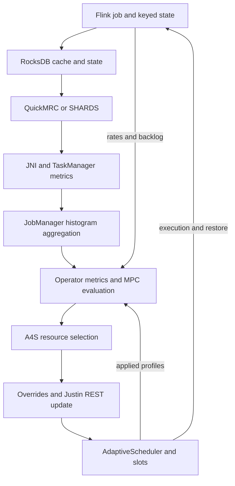

# AGENTS.md - ECE496 A4S

## 1. Mission, scope, and reading order

**A4S is this project's memory-aware autoscaler for stateful Apache Flink systems.** It predicts how RocksDB cache capacity affects processing capacity, combines that prediction with per-vertex throughput demand, and chooses memory and parallelism through Flink's resource-management mechanisms. The objective is to sustain the workload and acceptable latency while using CPU and memory efficiently and preserving application state and output. Evaluate the complete transition: state restore, cold caches, provisioning, processing interruption, and backlog can outweigh an attractive steady-state allocation.

This guide is a repository-root entry point. Paths are relative to this repository unless explicitly marked external or branch-only. Before building or running experiments, open the complete relevant sections from this file; automatic startup context may contain only an excerpt. In the ECE496 multi-checkout workspace, also read the workspace-level `AGENTS.md` and `LAB_EXPERIMENT_RUNBOOK.md` for lab procedures and launcher locations.

**Inspected baseline:** [`johnymeng/flink-kubernetes-autoscaling`](https://github.com/johnymeng/flink-kubernetes-autoscaling), `main` at `b17d7eeae5c3d0262b03388146bddd46d1f3108a`, reviewed November 26, 2026. Source and command interfaces were inspected; this documentation pass did not rebuild the stack or run cluster experiments. Future readers must reconcile this snapshot with their checkout.

Read in this order:

1. This section and [the startup checklist](#2-start-each-task-with-a-concrete-system-identity).
2. [Directory ownership](#3-repository-map) and [the component flow](#4-how-the-components-connect).
3. [Contracts and current limits](#5-contracts-that-changes-must-preserve).
4. [Build](#7-build-the-matching-a4s-stack), [test](#8-test-the-owning-layer), and [experiment](#9-select-the-right-experiment-protocol) sections relevant to the task.
5. The selected experiment's actual runbook and [source index](#14-source-index-and-how-to-maintain-this-guide).

### Research lineage

| System | Main idea | Relationship to this code |
| --- | --- | --- |
| DS2 | Estimate true processing capacity and propagate throughput requirements through the job DAG; adjust task parallelism. | Baseline throughput analysis and horizontal scaling machinery. DS2 is more than a CPU-threshold rule. |
| Justin | Use cache/state-access signals to probe memory increases, then adjust parallelism when further memory is ineffective. | Existing resource-profile and native scheduling integration reused by A4S; selectable policy baseline. |
| Original A4S | Use miss-rate curves (MRCs) and memory-parallelism curves (MPCs) to jointly reason about memory, parallelism, and placement. | Wang's 2023 thesis implemented this in RisingWave. Its full placement algorithm is not automatically present in this Flink port. |
| Flink A4S | Instrument RocksDB, aggregate per-vertex MRCs, evaluate candidate memory/parallelism, and issue resource updates. | The principal implementation in the current A4S runtime and operator trees. |

The November implementation plan selects **SHARDS** as the replacement estimator. Current main keeps **QuickMRC as the default** and makes SHARDS opt-in. Online service-cost calibration, time-aware curves, and migration-aware optimization are development directions with branch-specific implementations or remaining work. Flink 2.x/ForSt is stretch scope; establish the Flink 1.18 baseline before treating a port as equivalent.

## 2. Start each task with a concrete system identity

Run from the checkout root:

```bash
git status --short
git branch --show-current
git rev-parse HEAD
git submodule status --recursive
rg --files -g AGENTS.md -g '*README*' -g '*instruction*' -g '*runbook*'
```

Then establish:

- **Implementation:** A4S runtime/operator, baseline Justin/DS2 stack, imported checkpoint-aware stack, or standalone branch.
- **Artifacts:** source revision, submodule pins, native JNI JAR, runtime image, benchmark JAR/image, operator image/chart, and effective configuration.
- **Workload:** DataStream or SQL, exact query implementation, source/input semantics, sink semantics, and state backend.
- **Experiment:** question being tested, fixed versus adaptive policy, native versus redeployment actuation, measurement window, and correctness oracle.
- **Ownership:** selected worktree, run ID, namespace, operator watch scope, broker/topics, state paths, output directory, and intended cleanup.

Read the applicable instructions in the selected checkout. Continue authorized work; preserve unrelated edits and use a task branch/worktree for implementation. This guide does not authorize changing unrelated deployments or resetting shared infrastructure.

Use **current source for implemented behavior**, deployed artifacts and live receipts for runtime claims, runbooks for their declared protocol, and papers/plans for design intent. Historical notes identify useful evidence and failure modes; resolve their revision and applicability before reusing them.

### Snapshot facts that prevent common mistakes

| Item | Current inspected main |
| --- | --- |
| Flink A4S source/artifacts | `1.18-SNAPSHOT`, Java 11 build. |
| A4S operator POM and image | `1.11-SNAPSHOT`. Older reports describe 1.13 or 1.16; those numbers do not identify this checkout. |
| Native library | Vendored FRocksDB 6.20.3 sources; custom Maven coordinate `org.rocksdb:frocksdbjni:6.20.3-custom`. |
| Root Git submodules | SQL Nexmark and Justin operator. FRocksDB is now tracked source, not a root submodule. |
| Generic operator default | `scripts/env.sh` selects the A4S source tree, but the generic default image tag is `justin-modified`. Inspect inputs rather than inferring behavior from the tag. |
| MRC transport | Gauge values use length-prefixed UTF-8 after PR #26. The older compressed histogram codec belongs to different work. |
| Q8 convenience tooling | No root Q8 launcher or `plot_run.py` in this snapshot. |
| `docs/experiment-flow.md` | Retained legacy SQL Q20/Kafka reset-and-replay flow; not the newer fs.csl/Q8 guide described in earlier workspace instructions. |

## 3. Repository map

### Top-level directories

| Path | Purpose and when to use it |
| --- | --- |
| [`sources/`](sources/) | Owning implementation trees. Select the correct runtime/operator variant before editing. |
| [`images/`](images/) | Dockerfiles, native build, workload packaging, and per-image entry points. Fix packaging here, not in deployment manifests. |
| [`scripts/env.sh`](scripts/env.sh) | Source paths, image names/tags, registry defaults, Maven artifact names. Check the effective values after sourcing. |
| [`scripts/images/`](scripts/images/) | Stack build, local verification, registry push and pre-pull helpers. Generic defaults are not a complete A4S build recipe. |
| [`scripts/autoscaling/`](scripts/autoscaling/) | Cluster maintenance, job management, observation, and port forwarding. Review scope and side effects before executing wrappers. |
| [`cluster/`](cluster/) | Lab/cloud configuration, operator deployment values, monitoring and storage. This is infrastructure configuration, not the A4S optimizer. |
| [`experiments/`](experiments/) | Workload manifests, protocols, producer coordination, export/plot tools, and checkpoint-run evidence. |
| [`docs/`](docs/) | Build/experiment documentation and the historical SHARDS port plan. Check status claims against the selected revision. |
| [`A4S.md`](A4S.md) | Short cross-layer architecture and configuration guide. Useful entry point; its version headings are historical. |
| [`README.md`](README.md) | Generic stack overview. Source defaults in executable scripts take precedence over stale examples. |

### Implementation trees

| Path | Ownership |
| --- | --- |
| [`sources/flink/flink-runtime-1-18-a4s/`](sources/flink/flink-runtime-1-18-a4s/) | A4S-enabled Flink fork: custom MRC module, RocksDB backend, metrics transport, REST endpoints, resource profiles, adaptive scheduling, and restore. |
| [`sources/flink/flink-1-18-src-from-justin/`](sources/flink/flink-1-18-src-from-justin/) | Baseline/Justin Flink fork selected by the generic runtime wrapper. Changes in the A4S tree do not automatically change this tree. Some shared repairs, including PR #26, touch both. |
| [`sources/operators/flink-kubernetes-operator-a4s/`](sources/operators/flink-kubernetes-operator-a4s/) | Vendored operator containing A4S policy, metrics collection, resource recommendations, and Kubernetes/Flink realization. |
| [`sources/operators/flink-kubernetes-operator-justin/`](sources/operators/flink-kubernetes-operator-justin/) | Separate pinned submodule. Initialize and inspect it before using a Justin/upstream experiment image. |
| [`sources/libs/frocksdb/`](sources/libs/frocksdb/) | Native RocksDB cache hooks, QuickMRC, SHARDS, JNI, native tests, trace replay, and `db_bench`. |
| [`sources/libs/rocksdb-options/`](sources/libs/rocksdb-options/) | Small Java RocksDB-options factory used by SQL experiments. Option changes can alter memory accounting and confound policy comparisons. |
| [`sources/benchmarks/nexmark-datastream-benchmarks-from-justin/`](sources/benchmarks/nexmark-datastream-benchmarks-from-justin/) | Java Nexmark jobs and internal sources: Query1/2/3/5/8/11 plus read/write/update workloads. Owns input, window, state, and sink semantics. |
| [`sources/benchmarks/nexmark-sql-benchmarks/`](sources/benchmarks/nexmark-sql-benchmarks/) | Pinned SQL Nexmark submodule and nested custom Kafka connector. Owns SQL definitions, generators, connector behavior, and SQL packaging. |

### Important subdirectories

Within **`sources/flink/flink-runtime-1-18-a4s/`**:

| Directory | Responsibility |
| --- | --- |
| `flink-a4s/` | `StackDistanceHistogram`, `MissRateCurve`, observation statuses, shared serialization/model types, and tests. |
| `flink-state-backends/flink-statebackend-rocksdb/` | Cache creation/settings, JNI-backed metrics, managed-memory sharing, and RocksDB state/checkpoint/restore integration. |
| `flink-runtime/` | Task/JobManager metrics, REST handlers, execution graph, resource requirements, slots, scheduler, checkpoints and recovery. |
| `flink-core/` | Common configuration, memory/resource primitives and public runtime contracts. |
| `flink-clients/`, `flink-runtime-web/`, `flink-kubernetes/` | REST client, web/runtime packaging, Kubernetes runtime integration; important matching build dependencies. |
| `flink-streaming-java/`, `flink-table/`, `flink-connectors/` | Streaming API/operators, SQL execution, and sources/sinks. Edit when the bug belongs to those semantics. |
| `flink-dist/` | Runtime distribution assembled into the container. |
| `flink-tests/`, `flink-test-utils-parent/`, other module `src/test/` trees | Integration fixtures, test utilities and focused tests. Use the owning module's tests first. |

Within **`sources/operators/flink-kubernetes-operator-a4s/`**:

| Directory | Responsibility |
| --- | --- |
| `flink-autoscaler/` | Metrics history, throughput evaluation, A4S MPC/policy, scaling limits, state store, and recommendations. |
| `flink-kubernetes-operator/` | Reconciliation, `KubernetesScalingRealizer`, `NativeFlinkService`, and deployment behavior. |
| `flink-kubernetes-operator-api/` | Flink custom-resource types and schema-facing models. |
| `flink-kubernetes-webhook/` | Admission and validation service. |
| `flink-kubernetes-standalone/` | Standalone Kubernetes deployment support. |
| `flink-autoscaler-standalone/`, `flink-autoscaler-plugin-jdbc/` | Upstream autoscaler service/state-store integration. These are distinct from the branch-only independent `sources/a4s` project. |
| `helm/`, `examples/`, `docs/`, `flink-kubernetes-docs/` | Chart/CRDs, examples, and upstream documentation. Match chart/API to the built operator. |

Within **`sources/libs/frocksdb/`**, `cache/` owns cache algorithms and online estimator; `table/block_based/` owns eligible data-block access hooks; `include/rocksdb/` exposes native interfaces; `java/src/` and `java/rocksjni/` bridge Java/native APIs; `trace_replay/` owns trace parsing, eligible-access filtering and the older offline estimator; `tools/` supplies replay and microbenchmarks. See the source index for exact estimator files.

### Operations and experiment directories

| Directory | Use |
| --- | --- |
| `images/frocksdb/` | Build matching native JNI JAR in the required Linux environment. |
| `images/flink-runtime-a4s/`, `images/flink-kubernetes-operator-a4s/` | Dedicated A4S build routes. |
| `images/flink-runtime/`, `images/flink-kubernetes-operator/` | Generic source/tag-selectable routes; inspect selected inputs. |
| `images/flink-benchmark-runtime/scripts/` | Build DataStream, SQL/connector, and RocksDB-options JARs before packaging. |
| `cluster/config/` | Registry, node, kubeconfig, and storage defaults. |
| `cluster/operator/`, `cluster/monitoring/`, `cluster/aws/` | Operator values, Prometheus/Grafana/RBAC, and cloud-specific infrastructure. |
| `scripts/autoscaling/cluster-management/` | Prerequisites, node labels, operator/monitoring deployment, status and broad reset operations. |
| `scripts/autoscaling/job-management/` | Submit/status/stop wrappers. Some rely on shared names/current namespace; stop may strip finalizers. |
| `scripts/autoscaling/job-monitoring/` | Live Flink metrics, autoscaler decisions, benchmark stability, port forwarding, and Python tool tests. |
| `experiments/1724-kafka-q20-unique/` | Q20 manifests, shared external Kafka/producer machinery, exporter, plotter, and comparison scripts. |
| `experiments/1725-kafka-q4-unique/` | Q4 experiment settings and DS2/Justin manifests. |
| `experiments/1726-kafka-q9-unique/` | Q9 experiment settings and DS2/Justin manifests. |
| `experiments/1727-kafka-q18-unique/` | Q18 experiment settings and DS2/Justin manifests. |
| `experiments/1728-kafka-q19-unique/` | Q19 experiment settings and DS2/Justin manifests. |
| `experiments/1729-checkpoint-aware-rescaling/` | Imported checkpoint transaction runner, five-query policy manifests, producer pause/resume, evidence and cleanup. Requires its documented upstream image contract. |

Store new evidence in a fresh `outputs/<run-id>/` or the selected runner's run directory. Treat these as generated outputs; keep secrets, large raw archives and binaries out of source commits. `outputs/` is a recommended convention, not a pre-existing directory or automatic ignore rule in this snapshot.

## 4. How the components connect



This diagram describes the **current embedded A4S path**. Kubernetes supplies infrastructure and worker placement; the operator evaluates policy; Flink executes stateful resource changes; native instrumentation supplies cache observations.

### 4.1 Workload and RocksDB state

A Flink job contains vertices and parallel subtasks. Keyed state is partitioned into key groups and stored through the selected state backend. Changing parallelism can change key-group ownership and require restoring state into new task attempts.

RocksDB writes enter memtables/write buffers, flush into SST files, and undergo compaction. Reads can hit the block cache or reach the storage stack. A cache miss can be served by the OS page cache; it does not necessarily imply a physical disk read. Compaction, checkpoint I/O and neighboring jobs can change service cost independently of cache hit ratio.

Flink can share a physical managed RocksDB cache among backends within a slot. A vertex, subtask, backend, physical cache, slot and TaskManager are different identities. The current SHARDS integration assumes **one stateful backend per slot** for attribution. Shared-pool optimization requires additional ownership/accounting work.

### 4.2 Native MRC estimation and JNI

**QuickMRC** estimates LRU reuse distances using approximate buckets, sampling, and a ghost cache of evicted identifiers. The ghost cache supplies history beyond resident data. Current native code samples resident hits with a shard-local PRNG, weights sampled frequencies and records ghost hits without that sampling; it is not the thesis's deterministic per-key sampling implementation. Charges are rounded to 4096-byte units before the Java byte conversion. Histogram counts describe reuse, not application state.

**SHARDS** deterministically samples block identities and tracks sampled recency with byte charges. The current implementation instruments eligible user data-block Get, MultiGet and iterator traffic, including miss/admission behavior. It is more specific than counting every generic cache lookup. The live cache and sampled estimator have distinct capacities.

Current defaults and semantics:

| Setting/behavior | QuickMRC | SHARDS |
| --- | --- | --- |
| Selection | Default `quickmrc` | Explicit `shards` |
| Observation history | Read/reset on metric updates, including ghost-history reset | Cumulative physical-cache-lifetime snapshots |
| Sampling | Configurable; default 0.01 | Configurable; default 0.01, seed 0 |
| Capacity representation | Bucket/item metadata converted to bytes | Byte-distance bins; default 1 MiB, maximum distance 4 GiB |
| Native coexistence | QuickMRC hook active when enabled | Selecting SHARDS disables the QuickMRC hook on that cache |
| Freshness implication | A sampled interval can be empty | Old access patterns persist until a new cache or explicit future windowing |

For the online SHARDS byte-LRU convention, a sampled reuse's minimum hitting capacity is **newer sampled bytes / sampling rate + the accessed block's own charge**. The own charge is not divided by the sampling rate. Apply the same convention to cap eviction and the final partial bin. Current main contains the sampled-hit cap correction and admission/accounting repairs; the port plan's earlier “still reproduces” statement is historical. Mixed no-fill/lookup-only admissions can violate the ordinary LRU stack monotonicity assumption; use independent per-capacity replay to check actual behavior. The distance cap bounds represented reuse distance, not estimator RSS.

Native SHARDS snapshots carry sampling/seed/bin/cap settings, total and sampled references, cap evictions, tracked entries/bytes and estimator time, followed by sampled-count bins. Preserve cumulative counters versus instantaneous gauges. Current QuickMRC also prints `quick_mrc_sampled_charge` to stderr on sampled hits; account for that instrumentation in overhead and cost-calibration studies.

`LRUCache.java` and its JNI implementation expose configuration/snapshots. `RocksDBSharedResourcesFactory`, `RocksDBMemoryControllerUtils` and `RocksDBSharedResources` create/manage the shared cache; `RocksDBNativeMetricMonitor` publishes the histogram. Once a second monitor has used the same Java `LRUCache`, the SHARDS ownership guard keeps its gauge unavailable because cache-lifetime history is mixed.

Monitor update/close share a lock, and backend disposal closes the monitor before releasing native resources. Preserve both mechanisms so queued polling cannot dereference a closed cache. Java handle assertions alone do not provide this coordination.

### 4.3 Metrics transport and JobManager aggregation

The TaskManager's metric query machinery serializes gauges and sends metric dumps over RPC. The JobManager's metric fetcher/store supplies the A4S handler. Follow:

`RocksDBNativeMetricMonitor` → `MetricQueryService` / `MetricDumpSerialization` → `MetricFetcher` / `MetricStore` → `A4SAggregatingVertexMetricsHandler`.

The custom endpoint is:

```text
GET /jobs/:jobid/vertices/:vertexid/a4s-metrics
```

The response carries `mrcStatus` and, when usable, `scaledMrc`. Statuses include `AVAILABLE`, `TASK_METRICS_UNAVAILABLE`, `HISTOGRAM_UNAVAILABLE`, `INCOMPLETE_HISTOGRAMS`, `NO_SAMPLES`, `NO_FINITE_BUCKETS`, `INVALID_HISTOGRAM`, `INVALID_RESPONSE`, `REQUEST_FAILED` and `UNAVAILABLE`. Some arise on the client side. A missing curve is an explicit observation outcome.

The handler recognizes raw/sanitized histogram names, including `rocksdb_stack-distance-histogram`, and rejects ambiguous multiple histograms per subtask. It validates histogram compatibility, completeness and finite samples. The SHARDS path additionally checks the current execution graph, all expected running subtasks and their current attempt numbers. Do not assume equivalent generation/freshness protection across every estimator path.

`StackDistanceHistogram` merges compatible frequencies; `MissRateCurve` converts their cumulative finite mass into miss fractions. SHARDS' infinite bin remains in the denominator, representing misses at every supported capacity. The runtime scales the **capacity axis** by vertex parallelism; the miss fraction remains in [0,1].

**PR #26 transport contract:** gauge values now use a 32-bit byte length followed by standard UTF-8; failed metric writes roll the output buffer back. Scope/name fields still use their existing encoding. Keep metric producers and consumers on matching runtime code. Larger gauges still consume RPC/message/memory budgets; removal of the old 65,535-byte value limit is not an unlimited-size guarantee.

### 4.4 Throughput evaluation and the MPC

The operator path is:

`JobAutoScalerImpl` → `RestApiMetricsCollector` / `ScalingMetricCollector` → `ScalingMetricEvaluator` → `MemoryParallelismCurve` → `A4S` → `ScalingExecutor`.

The ordinary autoscaler derives processing capacity, observed demand, backlog and topology/selectivity information. `RestApiMetricsCollector` also fetches usable vertex MRCs. `ScalingMetricEvaluator` builds MPCs from the usable curves in the latest metrics collection and `TARGET_DATA_RATE`. If the latest collection has no usable curve for a vertex, the evaluator skips its MPC.

Conceptually, for an operator:

- `P` is task parallelism.
- `T` is target input records/second.
- `M` is total operator cache capacity; under balanced partitioning, per-task capacity is `M/P`.
- `r(M)` is miss fraction.
- `h` and `l` are compatible effective hit and total-miss service costs, in seconds per input record.

```text
service_cost(M) = h + r(M) * (l - h)
predicted_rate(P, M) = P / service_cost(M)
maximum_miss_fraction(P, T) = (P / T - h) / (l - h)
```

Invert the MRC at that miss fraction for each legal `P` to obtain a memory-parallelism curve. A larger parallelism can tolerate more misses, permitting a different memory allocation.

Current main uses configured **5 microseconds hit** and **5 milliseconds total miss** by default. The incremental miss cost is **4.995 milliseconds**. These are model assumptions, not measured device latency. A raw time per cache access must be related to accesses per input record before using it as a record-processing cost.

The original thesis assumes approximately balanced partitions, reasonably stable access behavior and storage performance. Test those assumptions under skew, topology changes, recovery and I/O contention.

Follow-on online-cost work separates frequency from time: `s(C,z) = b(z) + a(z) * r(C,z) * d(z)`, where `s` and `b` are seconds/input record, `a` is eligible accesses/record, `r` is miss fraction and `d` is incremental seconds/miss. Context `z` includes hardware, placement, cache ownership and execution phase. This is a modeling framework for the prior branch work, not a current-main calibrated predictor. Align its observations and hold or requalify on a context change; a fitted slope is not automatically physical disk latency.

### 4.5 A4S selection

`A4S.makeDecision` starts from ordinary recommended parallelism, or current parallelism when no recommendation exists. It considers vertices with MPCs, attempts a memory-feasible configuration, and increments the vertex whose next parallelism offers the largest memory decrease. The search is bounded by `job.autoscaler.a4s.max-attempts`, default 20.

This implementation is a limited heuristic. Its current placement check uses **600 minus `job.autoscaler.a4s.memory-base.mb` MiB** as a memory bound. It is not the complete worker-level CPU/memory placement algorithm from the RisingWave thesis.

Keep demand semantics consistent: current MPC construction consumes `TARGET_DATA_RATE`, while ordinary scaling has additional utilization/restart/backlog logic. If changing prediction or policy, verify that the final recommendation preserves the intended catch-up capacity.

### 4.6 Recommendation, resource profiles and realization

`ScalingExecutor` evaluates A4S when both Justin and A4S are enabled. It runs before the final no-change gate, so a managed-memory change can produce an action without a parallelism change.

Before preserving or changing resources, it requests:

```text
GET /jobs/:jobid/justin?include-applied-profile=true
```

It requires known, round-trippable applied profiles for all evaluated vertices before acting. The scheduler withholds a vertex's applied profile if any subtask uses a shared physical slot or if the subtasks have different slot profiles. In either case the executor defers the entire action, including a resize proposed for another vertex. When all required profiles are confirmed, vertices without a usable A4S decision retain their deployed resources. Never translate “no MRC” into zero managed memory.

For a chosen vertex, the executor preserves other profile fields and changes managed memory, rounding up to whole MiB. It stores parallelism/profile overrides in the autoscaler state store. `JobAutoScalerImpl` applies them through `KubernetesScalingRealizer`, which updates `pipeline.jobvertex-parallelism-overrides` and `pipeline.jobvertex-resourceprofile-overrides` in the deployment configuration.

`NativeFlinkService` reads the Justin requirements, merges proposed overrides and submits:

```text
PUT /jobs/:jobid/justin
```

Native in-place support depends on the selected configuration/runtime, including the adaptive scheduler and supported reconciliation state. Removing overrides or an unsuccessful native update can cause the service to fall back to the normal upgrade path. Record which route actually occurred.

### 4.7 Scheduler, resource allocation and recovery

`AdaptiveScheduler` applies Justin requirements to vertex/slot-sharing resource information, declares desired profiles and constructs a target scheduling plan. `JustinSlotAssigner` matches target work to compatible slots. Current repairs retain useful slots, wait for the full desired resource set, and accommodate updated requirements while waiting.

Flink still creates/restores executions as required. Kubernetes supplies additional workers if the runtime requests them and capacity permits. Reusing a worker or slot does not establish that task attempts, RocksDB instances or warm cache contents survived.

Measure separately:

1. Decision issued.
2. Resource update acknowledged.
3. Every target subtask in the expected new roster is `RUNNING`.
4. Processing resumes.
5. Sustained target capacity returns.
6. Backlog clears or reaches the declared steady-state criterion.

A native resource update is not a promise of a fresh savepoint, restart-free cache resizing, or sub-10-second recovery.

## 5. Contracts that changes must preserve

### 5.1 Units and ownership

| Quantity | Meaning |
| --- | --- |
| Cache capacity | Bytes the physical cache can retain under its configured policy. |
| Cache usage | Occupancy at observation time; can be below capacity during warm-up. |
| Managed-memory reservation | Flink resource allocation shared with relevant RocksDB memory consumers. |
| Write-buffer/memtable memory | Write path memory; shrinking it can create flush/compaction pressure. |
| Metadata/pinned memory | Index/filter/table-reader and pinned-block overhead, with implementation-specific accounting. |
| Process RSS / cgroup memory / pod limit | Different process/container measurements and constraints. |
| Operator-total memory / per-task memory | Related through task partitioning and model assumptions; never interchangeable without conversion. |
| Requested / acknowledged / applied | Policy intention, accepted control request, and independently observed running allocation. |

The runtime's MRC byte axis is scaled by partition count. SHARDS validates the execution graph's current parallelism; QuickMRC uses merged histogram `numPartitions` from the metric-store roster without the same graph/attempt checks. Current MPC code converts the scaled bytes to MiB, and the executor uses the result as a per-slot managed-memory request plus base memory. Validate that boundary explicitly; it is not a calibrated cache-to-managed-memory conversion for a new candidate parallelism.

For managed RocksDB budget `B` and write-buffer ratio `w`, the current allocator sets cache capacity to `(3-w)B/3` and write-buffer-manager capacity to `2Bw/3`. The write-buffer manager charges against the shared cache, so these values cannot be added as independent available data-cache budgets. Index/filter blocks are kept outside this shared cache by the current resource-container configuration; measure their memory separately.

### 5.2 Telemetry qualification

Preserve identities and intervals wherever the selected branch supports them. For new telemetry/model work, make job, vertex, subtask, attempt, worker process, physical cache/generation, estimator settings, capacity, observation population and interval explicit.

- Merge only compatible histograms; retain counts and cold/overflow mass.
- Distinguish unavailable, malformed, stale and measured-zero observations.
- Requalify after restart, cache recreation, ownership/capacity/parallelism changes.
- Align counter deltas, busy time, record counts and histogram intervals.
- Count a shared physical cache once and attribute it only when ownership is supported.
- Treat cumulative SHARDS differencing/windowing as additional work unless the selected branch implements it. Main publishes cache-lifetime curves.
- Preserve exact resource-profile bytes through serialization, including fractional display units and mixed/shared allocation cases.

### 5.3 Current implementation limits to investigate, not silently assume solved

| Area | Source-inspected behavior and implication |
| --- | --- |
| MPC feasibility | `MemoryParallelismCurve.fromMissRateCurve` throws when the acceptable miss fraction is nonpositive at a candidate. A later feasible parallelism may exist; test the infeasible-prefix boundary. |
| Unsupported miss target | `MissRateCurve.leastMemoryBytesForMissRate` can return a plateau-based fallback when no point achieves the target. That return does not certify feasibility. |
| Placement | `A4S.java` contains the 600 MiB heuristic, not full cluster packing or locality optimization. |
| Budget accounting | Check all retained vertices, per-slot sharing and ceiling worker counts. Existing quota helpers and ordinary throughput summaries are not a proof that every A4S memory request fits. |
| Telemetry freshness | SHARDS has current-attempt checks but cumulative history; full physical-cache epoch/ownership/time-window contracts are not universal main behavior. |
| Workload recovery | Current main DataStream Q8 sources lack checkpointed cursors; a successful restore of operator state alone cannot prove input continuity. |
| Cost calibration | Main uses fixed configured service costs; prior online estimator branches do not become active by selecting SHARDS. |
| Transport | Sender/receiver must share the PR #26 wire format. Gauge lengths still need sensible resource bounds. |
| State/output correctness | Neither a discard sink nor a graph reaching `RUNNING` proves output completeness. |

Use these as test/design boundaries. Reproduce a suspected defect on the task's actual base before reporting it as a current failure or expanding the task.

## 6. Configuration and policy selection

Place Flink settings under `spec.flinkConfiguration`. This is a **partial configuration**, not a complete deployment manifest:

```yaml
spec:
  flinkConfiguration:
    jobmanager.scheduler: Adaptive
    job.autoscaler.enabled: "true"
    job.autoscaler.scaling.enabled: "true"
    job.autoscaler.justin.enabled: "true"
    job.autoscaler.a4s.enabled: "true"
    job.autoscaler.a4s.max-attempts: "20"
    job.autoscaler.a4s.hit-latency-sec: "0.000005"
    job.autoscaler.a4s.miss-latency-sec: "0.005"
    state.backend.rocksdb.memory.managed: "true"
    state.backend.rocksdb.metrics.stack-distance-histogram: "true"
    state.backend.rocksdb.a4s.mrc-estimator: shards
    state.backend.rocksdb.a4s.shards.sampling-rate: "0.01"
    state.backend.rocksdb.a4s.shards.hash-seed: "0"
    state.backend.rocksdb.a4s.shards.bin-size: 1mb
    state.backend.rocksdb.a4s.shards.max-distance: 4gb
```

The job must actually use the RocksDB backend. SHARDS validation requires managed memory and rejects fixed-per-slot memory. The histogram publication gate defaults to false; selecting an estimator alone does not publish metrics. Match runtime, operator, chart, CRD and native library; the snippet alone does not establish that.

| Purpose | Required choice |
| --- | --- |
| A4S adaptive policy | Autoscaler/scaling enabled, Justin enabled, A4S enabled, supported realization path and valid metrics. |
| Justin policy | Justin enabled, A4S disabled, matching baseline implementation. |
| DS2-style baseline | Justin and A4S disabled; verify the actual throughput policy and runtime variant. |
| Fixed-allocation estimator comparison | `job.autoscaler.scaling.enabled: "false"`, identical applied profiles; vary only the estimator. |
| QuickMRC comparison | `state.backend.rocksdb.a4s.mrc-estimator: quickmrc` on matching artifacts. |
| Constant memory experiment | Explicit `job.autoscaler.a4s.managed-memory-override.enabled` and positive `job.autoscaler.a4s.managed-memory-override.mb`. This is a distinct experimental mode. |

Estimator selection is applied when the cache is constructed. Changing YAML is not evidence of a live cache switch. Record task/cache creation and confirm telemetry.

Also inspect vertex min/max parallelism, source partition limits, slot-sharing, CPU/memory quotas, worker limits, stabilization windows and restart/catch-up settings. A removed five-worker cap in an old run does not establish unlimited capacity in a new deployment.

## 7. Build the matching A4S stack

### 7.1 Requirements and provenance

Use Linux amd64 or verified emulation, Docker with BuildKit named contexts, Git/submodule access, and sufficient build disk/RAM. The dedicated images use Maven 3.8.8 and Java 11. Benchmark packaging also requires **host JDK 11 and Maven**; the Docker build's Maven repository does not populate the host's repository.

FRocksDB is built in Ubuntu 22.04 for its native/glibc requirements. Build Java bindings and native code together. A stale JAR can have the same `6.20.3-custom` coordinates as a new one.

From the repository root, initialize and select unique aligned tags:

```bash
set -euo pipefail
git submodule update --init --recursive
export DOCKER_DEFAULT_PLATFORM=linux/amd64
a4s_tag="a4s-$(git rev-parse --short HEAD)-$(date -u +%Y%m%d%H%M%S)"
export FLINK_RUNTIME_IMAGE_TAG="$a4s_tag"
export FLINK_RUNTIME_A4S_IMAGE_TAG="$a4s_tag"
export FLINK_BENCHMARK_IMAGE_TAG="$a4s_tag"
export OPERATOR_IMAGE_TAG="$a4s_tag"
export OPERATOR_A4S_TAG="$a4s_tag"
export OPERATOR_SOURCE_DIR=sources/operators/flink-kubernetes-operator-a4s
source scripts/env.sh
```

The remaining root submodules use SSH URLs. Use the environment's configured authorized Git access; do not rewrite pins or substitute arbitrary branches to get a build through.

### 7.2 Native library and host dependencies

```bash
bash images/frocksdb/build.sh
test -f "$FLINK_RUNTIME_A4S_SOURCE/rocksdbjni-6.20.3-linux64.jar"
```

The native wrapper builds `sources/libs/frocksdb`, writes its JAR under `java/target/`, and copies the Linux JAR into the A4S runtime source root. It does **not** apply a separate patch list in this snapshot.

If the host Maven repository lacks matching Flink artifacts, install them before workload packaging or host tests:

```bash
mvn -B -ntp install:install-file \
  -Dfile="$FLINK_RUNTIME_A4S_SOURCE/rocksdbjni-6.20.3-linux64.jar" \
  -DgroupId=org.rocksdb -DartifactId=frocksdbjni \
  -Dversion=6.20.3-custom -Dpackaging=jar

mvn -B -ntp -f "$FLINK_RUNTIME_A4S_SOURCE/pom.xml" -T 4 \
  clean install -DskipTests -Dspotless.check.skip=true \
  -Drat.skip=true -Dcheckstyle.skip
```

This is a dependency/packaging build, not test evidence. A verified targeted reactor build may replace the full host install; include required parent POMs and test JARs. The A4S operator Dockerfile documents its own exact prerequisite module list.

### 7.3 Runtime, benchmark and operator images

```bash
bash images/flink-runtime-a4s/build.sh --tag "$a4s_tag"

bash images/flink-benchmark-runtime/build.sh \
  --runtime-image "$FLINK_RUNTIME_A4S_LOCAL" \
  --tag "$a4s_tag" --force-datastream-build

bash images/flink-kubernetes-operator-a4s/build.sh

docker tag "$OPERATOR_A4S_IMAGE" "$OPERATOR_LOCAL"
bash scripts/images/verify-images.sh
```

The dedicated operator wrapper creates a **registry-qualified local tag**; the explicit local retag above aligns it with generic verification/push tooling. It uses `--build-context flink-src=...` to compile against the matching A4S runtime sources.

The benchmark image places DataStream JARs at `/opt/flink/examples/justin/` and SQL/options/Kafka JARs at `/opt/flink/lib/`. Force a DataStream rebuild when workload code changes. Inspect SQL build logs and JAR freshness: its wrapper can tolerate a Maven failure if an expected older artifact already exists.

**Preview support is script-specific:**

```bash
bash images/flink-runtime-a4s/build.sh --tag "$a4s_tag" --dry-run
bash images/flink-benchmark-runtime/build.sh \
  --runtime-image "$FLINK_RUNTIME_A4S_LOCAL" \
  --tag "$a4s_tag" --force-datastream-build --dry-run
bash scripts/images/push-images.sh all --no-prepull --dry-run
```

The native and dedicated A4S operator wrappers have **no argument parser**: passing `--help` or `--dry-run` still runs their Docker commands. Read them directly. `build-all-default.sh` is not a replacement for this A4S sequence.

### 7.4 Release and deployed identity

For an authorized release, use the reviewed registry and aligned tags. `push-images.sh all --no-prepull` pushes without the default SSH pre-pull side effect. Inspect operator deployment values and watch scope before applying the matching image/chart.

Record source/submodule SHAs, exact commands, JAR/JNI SHA-256 hashes, local image IDs, pushed digests and pod `imageID` values. Verify the operator as well as JobManager and TaskManagers. A tag or manifest alone does not prove what ran.

## 8. Test the owning layer

Select focused tests for the changed behavior and relevant neighbors. Confirm a nonzero executed test count and inspect Surefire reports. Docker packaging skips tests. Use the same matching Maven dependencies/JNI artifacts as the intended deployment.

```bash
# From sources/flink/flink-runtime-1-18-a4s:
mvn -pl flink-a4s \
  -Dtest=StackDistanceHistogramTest,MissRateCurveTest test

mvn -pl flink-runtime \
  -Dtest=A4SAggregatingVertexMetricsHandlerTest,A4SMissRateCurvePublicationTest,MetricDumpSerializerTest,MetricQueryServiceTest test

# From sources/operators/flink-kubernetes-operator-a4s:
mvn -pl flink-autoscaler \
  -Dtest=A4STest,MemoryParallelismCurveTest,ScalingMetricEvaluatorTest,ScalingExecutorTest,RestApiMetricsCollectorTest test
```

Additional test routing:

| Change | Useful tests / verification |
| --- | --- |
| Missing/invalid curves, bins, merged counts | `StackDistanceHistogramTest`, `MissRateCurveTest`, publication/handler/response tests. Include absent, empty, malformed, mixed settings and partial current rosters. |
| Native cache hooks or SHARDS | `shards_mrc_estimator_test`, `lru_cache_test`, `block_cache_tracer_test`; exact byte-LRU replay at boundaries and variable charges. |
| JNI or monitor lifecycle | `LRUCacheTest` with the freshly built native library; `RocksDBNativeMetricMonitorTest`; concurrent poll/close and recreated cache. |
| Memory creation/sharing | `RocksDBMemoryControllerUtilsTest`, `RocksDBSharedResourcesFactoryTest`; actual cache/write-buffer allocation checks. |
| Profile transport / resource preservation | `JustinResourceRequirementsSerializationTest`, `JustinResourceRequirementsHandlerTest`, executor and native-service tests; exact bytes and shared/unknown profiles. |
| Native scheduling | `AdaptiveSchedulerTest`, `JustinSlotAssignerTest`, `SlotSharingSlotAllocatorTest`; partial arrivals, updates while waiting, retained slots and target completion. |
| Recovery | Failure/cancellation, source positions, shared checkpoint files, full output/state oracle, and a subsequent checkpoint/restore. |
| Monitoring/runner tooling | Python unit tests plus a scoped collection smoke; these do not validate runtime transactions. |

Native target example, from `sources/libs/frocksdb` with compatible compiler/dependencies:

```bash
make -j4 shards_mrc_estimator_test lru_cache_test block_cache_tracer_test shards_trace_replay
./shards_mrc_estimator_test
./lru_cache_test
./block_cache_tracer_test
```

The replay tool accepts **RocksDB binary block-cache traces**:

```text
./shards_trace_replay --estimator TRACE OUTPUT R BIN_BYTES MAX_DISTANCE_BYTES [HASH_SEED]
./shards_trace_replay --capacities TRACE OUTPUT CAPACITY_BYTES [CAPACITY_BYTES ...]
```

`--estimator` reuses the online algorithm; `--capacities` runs independent byte-capacity LRUs and is suitable as an accuracy reference on a complete eligible trace. The older default offline mode uses sampled block counts and optional GNU policy-based trees. Do not label agreement with the same implementation as independent accuracy validation.

Tooling tests, from root:

```bash
python3 -m unittest discover \
  -s scripts/autoscaling/job-monitoring/tests -p 'test_*.py'
python3 -m unittest discover \
  -s experiments/1729-checkpoint-aware-rescaling -p 'test_*.py'
```

If using Maven `-am` with an explicit test selector, prerequisite modules may need `-Dsurefire.failIfNoSpecifiedTests=false`. Still require the intended target tests to execute. Keep compile success, passing tests, bounded integration, deployed smoke and performance results as separate evidence levels.

## 9. Select the right experiment protocol

Before deploying, read [`docs/experiment-flow.md`](docs/experiment-flow.md) and the chosen experiment's README/instructions, then resolve their image/source contract. The existing flow is historical Q20 reset-and-replay; it does not define every A4S trial.

| Experiment | Appropriate use | Critical condition |
| --- | --- | --- |
| DataStream Q8 | Integration, controlled memory/parallelism studies, comparison with the inherited Figure 10 workload. | Internal Person/Auction sources; current main needs additional work for a stateful input/output oracle. |
| SQL 1724-1728 | Q20/Q4/Q9/Q18/Q19 baseline comparisons using existing Kafka tooling. | The legacy coordinator resets Kafka and replays after rescaling; label that protocol explicitly. |
| 1729 checkpoint-aware runner | Producer pause, checkpoint, restore, resume transaction experiments. | Build/run its documented matching upstream stack; importing scripts does not implement the controller protocol in main. |
| Bounded correctness smoke | Prove state/input/output continuity across a specified action. | Deterministic input and complete committed output/state comparison. |
| Fixed-profile estimator test | Compare QuickMRC/SHARDS accuracy and overhead. | Same allocation, access stream, accounting, settings and independent reference; scaling disabled initially. |

### 9.1 DataStream Q8 specifics

Find `Query8.java` and its source functions under the DataStream benchmark tree with `rg --files ... | rg 'Query8|PersonSourceFunction|AuctionSourceFunction'`.

Current main joins Person IDs to auction sellers in tumbling event-time windows; default window is 10 seconds. Default source targets are 30,000 Person and 50,000 Auction events/second **per source subtask**. Relevant arguments include:

```text
--person-srcRate
--auction-srcRate
--p-person-source
--p-auction-source
--p-window
--window-size
--disabledOperatorChaining
```

Pass `--auction-srcRate` explicitly because an additional read of that parameter has no default. Increasing source parallelism changes offered load; current sources also begin with the same ID sequence. Inspect arguments and generator semantics before calling a workload “80k/s.”

The source counters are ordinary fields without a checkpointed-source state interface in this snapshot. The sink discards output, and checkpoint cleanup is configured as `DELETE_ON_CANCELLATION`. Historical checkpoint-50/source-cursor proofs apply to their own patched builds, not this source automatically.

A Q8 run needs a reviewed manifest selecting the matching benchmark image/JAR, sources, slot groups, memory, checkpoint/storage and policy settings. There is no verified current-main command corresponding to the attachment's old Figure 10 launcher.

### 9.2 Legacy Kafka runs

1724 supplies shared Kafka/producer machinery used by 1725-1728. Inspect the mixed event population: offered broker events can exceed records consumed by a particular query.

`scaling-kafka-coordinator.py` stops the producer, resets topics and replays from the beginning after a rescale. This can answer a reset-workload comparison; it cannot demonstrate continuous stateful input preservation. Run-env scripts can overwrite kubeconfig and workload settings, so recheck effective scope after sourcing.

### 9.3 Imported checkpoint-aware 1729 runner

Read [`instruction.md`](experiments/1729-checkpoint-aware-rescaling/instruction.md), [`README.md`](experiments/1729-checkpoint-aware-rescaling/README.md), and `run-env.sh` first. The instructions pin an upstream `a4s-shards-mrc` stack at `7d3211a532aa6db3745830f5b7734d42b33c562b`. Its runtime/operator migration was separate from the main SHARDS telemetry port.

Settings include `QUERY=q4|q9|q18|q19|q20`, `POLICY=ds2|justin|a4s`, a unique `RUN_ID` and `EXPERIMENT_PROFILE=paper|normalized`. Paper manifests include A4S. The normalized AWS directory has DS2/Justin manifests, not a ready A4S equivalent.

For a render-only check after selecting that contract:

```bash
export QUERY=q20 POLICY=a4s
export RUN_ID="$(date -u +%Y%m%d%H%M%S)-q20-a4s"
source experiments/1729-checkpoint-aware-rescaling/run-env.sh
bash experiments/1729-checkpoint-aware-rescaling/render-job.sh
```

Inspect `RENDERED_MANIFEST` and effective images/source/chart afterward. The run environment selects the Justin operator path and has its own image defaults. Manifests use the deployment name `flink`; namespace and all helper scopes must be made consistent before application.

For checkpoint-gated trials, start the producer only when the consumer/transaction controller is ready. Pause and resume the **same producer** across the checkpoint. Resetting its broker between transitions changes the protocol. `checkpoint-producer-controller.py`, `manage-transaction.sh` and `collect-evidence.sh` support that workflow; inspect failed phases before retrying or cleaning up.

## 10. Execute and observe an isolated run

### 10.1 Prepare the run

Use a unique run ID, run-owned namespace or isolated virtual cluster, matching operator watch scope, and isolated input/state/evidence resources. Confirm actual nodes, free capacity, pressure, storage/mounts and competing work. Current repository configuration describes c165 as control/registry and c167/c182 as workers; older Kafka runs use c153. Verify live roles and access rather than assuming that history establishes availability.

For a reviewed rendered manifest, choose the run identity once and retain it throughout the trial. Keep namespace names lowercase and DNS-compatible. Set `RUN_CONTEXT` to the verified configured context. For 1729, retain its previously selected `RUN_ID` and rendered manifest; for a new generic trial:

```bash
RUN_ID="a4s-$(date -u +%Y%m%d%H%M%S)"
RUN_NS="$RUN_ID"
RUN_DIR="$PWD/outputs/$RUN_ID"
DEPLOYMENT=flink
mkdir -p "$RUN_DIR"
kubectl config current-context
kubectl --context "$RUN_CONTEXT" get nodes -o wide
kubectl --context "$RUN_CONTEXT" get pods -A -o wide
```

Set `MANIFEST` to the reviewed **run-scoped** file. Keeping deployment name `flink` inside a fresh namespace matches the current collectors' `flink-taskmanager-.*` pod pattern. A different deployment name requires adapting that selector. Create the namespace only when new, verify ownership if reusing one, and configure RBAC/operator/monitoring scope before deployment:

```bash
kubectl --context "$RUN_CONTEXT" create namespace "$RUN_NS"
kubectl --context "$RUN_CONTEXT" label namespace "$RUN_NS" ece496-run-id="$RUN_ID"
kubectl --context "$RUN_CONTEXT" -n "$RUN_NS" apply --dry-run=server -f "$MANIFEST"
kubectl --context "$RUN_CONTEXT" -n "$RUN_NS" apply -f "$MANIFEST"
kubectl --context "$RUN_CONTEXT" -n "$RUN_NS" get flinkdeployments,pods,services -o wide
```

A namespace flag does not override a conflicting `metadata.namespace` inside a manifest or fix hard-coded monitoring queries. Review all resource names and helper selectors. Broad cluster-reset scripts are maintenance operations, not normal trial setup.

### 10.2 Establish startup and artifact parity

Before starting measurement or releasing external input:

- Save the rendered manifest, source revisions, effective policy flags and initial requested/applied profiles.
- Verify job and expected source/subtask rosters, placement, native/JAR/image identities, checkpoint configuration and storage access.
- Confirm source metrics endpoints are available.
- For matched arms, require equivalent input/state/starting allocations and resource limits.
- For adaptive experiments, let the built-in operator choose/apply the action. Label manually forced transitions as actuation tests.

After releasing external input or starting timed in-job input, confirm that input counters advance and verify metric coverage for the measurement window.

Declare either a fixed-duration trial or a stability-terminated protocol. In the shared ECE496 workspace, stop every new benchmark at or before **600 seconds**, even if the experiment has a longer default. If still restoring at cutoff, record that outcome and the full actual/target roster.

### 10.3 Collect live state and diagnostics

Use a run-owned JobManager port-forward or other verified endpoint. Choose a free `FLINK_LOCAL_PORT`, confirm the service name, and keep this running in a separate terminal until collection is complete:

```bash
kubectl --context "$RUN_CONTEXT" -n "$RUN_NS" \
  port-forward --address 127.0.0.1 svc/flink-rest "$FLINK_LOCAL_PORT:8081"
```

Set `FLINK_URL` to `http://127.0.0.1:<chosen-port>` and select `JOB_ID` and `VERTEX_ID` from that actual job:

```bash
curl --fail --silent --show-error "$FLINK_URL/jobs/overview"
curl --fail --silent --show-error \
  "$FLINK_URL/jobs/$JOB_ID/vertices/$VERTEX_ID/a4s-metrics"
curl --fail --silent --show-error \
  "$FLINK_URL/jobs/$JOB_ID/justin?include-applied-profile=true"

kubectl --context "$RUN_CONTEXT" -n "$RUN_NS" get flinkdeployments,pods,services -o yaml \
  > "$RUN_DIR/kubernetes.yaml"
kubectl --context "$RUN_CONTEXT" -n "$RUN_NS" get events --sort-by=.metadata.creationTimestamp \
  > "$RUN_DIR/events.txt"
```

Save JobManager, TaskManager and operator logs using their verified pod names; the operator may live in a different namespace. Record pod UIDs/restart counts, attempts, checkpoints and timestamps.

The live metric observer supports explicit scope. Set `JOB_NAME` to the exact job name and `PROM_URL` to the verified reachable Prometheus endpoint:

```bash
python3 scripts/autoscaling/job-monitoring/observe-flink-metrics.py \
  --namespace "$RUN_NS" --job-name "$JOB_NAME" --flink-url "$FLINK_URL" \
  --prometheus-url "$PROM_URL" --once --json \
  > "$RUN_DIR/metrics-snapshot.json"
```

Confirm pod-name/job selectors match the deployment. Some other tools, including the existing exporter and scaling-history observer, do not expose a namespace flag and contain default-name assumptions. Adapt/verify their query scope before using them for isolated runs.

For compatible 1729 runs, `observe-benchmark.py` distinguishes capacity-stable/catching-up, lag-flat and fully-caught-up conditions. Its stability windows and live-producer checks are part of that protocol. `--exit-when-stable` stops the observer, not the workload.

### 10.4 Export and plot

The legacy exporter has **no namespace option** and hard-codes `default` in some queries. Use these commands only for its verified supported scope, or first adapt a reviewed helper copy to the isolated run. A successful export from the wrong namespace would give misleading resource totals.

Existing SQL export/plot tools, from root:

```bash
python3 experiments/1724-kafka-q20-unique/analysis/export-experiment-data.py \
  --name "$RUN_ID" --deployment "$DEPLOYMENT" \
  --flink-url "$FLINK_URL" --prom-url "$PROM_URL"

python3 experiments/1724-kafka-q20-unique/analysis/plot-experiment.py \
  "$EXPORTED_RUN_DIR" --output "$RUN_DIR/overview.png"

python3 experiments/1724-kafka-q20-unique/analysis/compare-justin-ds2.py \
  "$LEFT_RUN" "$RIGHT_RUN" --output "$RUN_DIR/comparison.png"
```

The exporter uses its own run directory under 1724; set `EXPORTED_RUN_DIR` to its actual output. Set `LEFT_RUN` and `RIGHT_RUN` to the intended paired outputs. The plotters consume that exporter directory schema, not the metric observer's JSONL. Python tooling requires the script's dependencies, including Requests/PyYAML/Matplotlib as applicable.

The existing plots emphasize source throughput and may omit missing samples or short segments. Use raw counters/events for precise join throughput and recovery analysis. Preserve zeros, gaps and ramps; do not interpolate downtime away. Label allocation versus usage and each rate's denominator.

Keep endpoints alive until export is complete. For every benchmark in the shared ECE496 workspace, generate and deliver the plot from the experiment's supplied Matplotlib renderer. The workspace lab runbook identifies the archived Figure 10 launcher and plotter. Archive a manifest/revision receipt, raw samples, decisions/holds, profiles, logs, rosters, checkpoints/input positions, plots, cutoff and cleanup result.

### 10.5 Teardown

Collect evidence first, stop owned input and jobs according to the chosen protocol, and remove only verified run-owned resources. Use a manifest/UID-scoped cleanup; verify no deployment can restore state before removing its complete run directory. Incremental checkpoints may share files, so deleting arbitrary SST/checkpoint fragments is unsafe.

The generic stop wrapper may remove finalizers after a timeout. Diagnose finalizers and resource ownership before invoking it. The 1729 cleanup helper targets its own paper/NFS layout and checks for live deployments; it is not a generic S3 cleanup tool. Exclude credentials and kubeconfigs from evidence archives.

## 11. Decide what the experiment demonstrated

### Rates and timing

Report offered input, query-relevant input, consumed input, operator-processed input and output separately. For Q8, use compatible-attempt **join-input counter deltas** for logical processing and explain coverage/window length. For Kafka, use defined per-partition absolute positions for backlog/continuity; summing reset task counters across attempts is invalid.

Over the same predeclared steady-state window, mean logical processing rate must be at least mean actual arrival rate, with ending backlog no greater than starting backlog. A paused producer, an empty workload, missing metrics mapped to zero, or a briefly high meter value cannot establish that condition.

Score each resize with decision, ACK, complete target roster, resumed processing, sustained recovery and backlog-clearance timestamps. The highest subtask index is not necessarily the last to finish.

### Correctness and comparison

Use deterministic bounded inputs and a complete committed output/state oracle. Respect multiplicity and SQL retract/upsert semantics. Include a later checkpoint/restore where recovery behavior changes. A successful job or discard sink only establishes limited execution evidence.

Match workload implementation, trace/seed, source rates/parallelism, state/input offsets, startup memory, runtime/JNI, metadata/write-buffer settings, worker/storage capacity and measurement windows. Change one intended factor at a time.

For estimator accuracy, compare the same access positions/capacity points against an independent reference. Measure profiling CPU/wall-time/memory overhead separately from memory given to the live cache. A complete trace/reference run can be distinct from an overhead run with tracing disabled.

For online models, split by whole trial, freeze parameters, and record predictions before held-out outcomes. Separate prospective MRC-based prediction from retrospective diagnostics using the eventual observed miss rate. Requalify after topology/ownership changes.

A useful later factorial comparison is QuickMRC/fixed cost, SHARDS/fixed cost, QuickMRC/online cost and SHARDS/online cost on the same repaired stack. This is a design, not a claim all four modes exist on main.

### Evidence ladder and reporting

Classify outcomes explicitly:

1. **Source inspected:** behavior/commands found in code.
2. **Focused tests passed:** actual selected tests and counts.
3. **Build verified:** reproducible artifacts with recorded identities.
4. **Deployed smoke:** intended artifacts/flags/metrics observed.
5. **Correctness verified:** bounded input/output/state continuity demonstrated.
6. **Performance measured:** qualified matched trials with variation and declared exclusions.

Record failed, held and inconclusive trials. If a model stayed disabled or fell back, report that path. Resource savings need matched provisioned/used metrics and sustained throughput; a lower managed-memory-used gauge alone is insufficient.

The revised implementation plan calls for Q5/Q9/Q20, constant and low-high-low inputs, matched repetitions, extended state-growth runs and bounded correctness cases. Treat its counts as planned acceptance work. Q8 remains a useful diagnostic workload. Lab validation and commercial-cloud deployment are separate milestones.

## 12. Prior work and branch-only extensions

### What is integrated in the inspected main

The source includes explicit MRC observation outcomes, sanitized histogram lookup, curve validation, preservation of confirmed applied profiles, memory-only recommendation handling, native slot reuse/readiness repairs, polling shutdown protection, vendored SHARDS/JNI integration, byte/admission accounting fixes, opt-in estimator selection, and the enlarged gauge transport.

Presence in source is not proof that a given image contains the fix or a given workload exercises it. Use the build/test/deployed evidence ladder.

### Branch and historical-work map

| Work | Snapshot / location | How to use it |
| --- | --- | --- |
| Online miss-cost model | `a4s-cache-miss-penalty` at `e7cc095a743dba32f40578d57b11be124d288012` | Prior telemetry/fitting implementation; verify population, intervals, qualification and actual policy use. |
| Miss timing instrumentation | `a4s-miss-penalty` at `4e2e0c96fef8b347203ca373b53bf26d61f2f016` | Measurement work distinct from active online decisions. |
| Recovery integration | `integration/a4s-recovery-grid` at `273a09a86795e1c9eaea329db1c31a069987ff43` | Branch-local recovery/telemetry experiments and codecs; reconcile with newer main fixes before porting. |
| Standalone extraction | `feat/a4s-standalone` at `8e9d9238c9f3075b0ba5d86d72cf0f0554d6265f` | Real independent-core/adapter implementation described below; absent from inspected main. |
| Plot updates | `fix/zero-based-experiment-plots` at `cc5a8f4935a9675b5865841a2cdedf5dc1eef608` | Branch-local tooling; do not assume its files are present on main. |
| Prior knowledge | [Obsidian ECE496 records](https://github.com/johnymeng/obsidian/tree/bbaeec9c46b7b82b44d505ddac5ea09ef763eb72/Agents/Agent%20Knowledge/knowledge/ece496) | Read benchmark-results for outcomes and design-summaries for methods. Unfinished work is in separate `Agents/Agent Knowledge/handoffs/ece496/` and `task-handoffs/ece496/` directories. |

Remote branch heads can move. Resolve current refs and merge ancestry before selecting code; the SHAs above identify the reviewed historical work.

### Standalone A4S architecture: branch-only

Read the [pinned standalone guide](https://github.com/johnymeng/flink-kubernetes-autoscaling/blob/8e9d9238c9f3075b0ba5d86d72cf0f0554d6265f/docs/a4s-standalone.md) and its verification document before using this branch.

| Branch-only directory | Responsibility |
| --- | --- |
| `sources/a4s/a4s-api` | Normalized snapshots, telemetry, constraints, policy state and scaling-plan types. |
| `sources/a4s/a4s-core` | Pure A4S evaluation, MRC/MPC and fixed cost model; performance/migration model interfaces. |
| `sources/a4s/a4s-http` | Versioned JSON, bounded decision client, snapshot recording/replay boundary. |
| `sources/a4s/a4s-runner` | HTTP evaluator and replay executable. |
| `scripts/a4s` | Dependency checks, comparisons, recovery smokes and profiling/latency tooling. |
| `cluster/a4s/runner.yaml` | Runner Deployment/Service. |
| Existing operator/runtime trees | Flink adapter, validation, persisted intent, conditional Justin update and stateful actuation. |

The default is embedded evaluation. Setting `job.autoscaler.a4s.runner.url` enables `POST /v1/evaluate` against the runner. The operator remains the sole stateful actuator; the runner does not need Flink/Kubernetes credentials or stream records. Remote evaluation failure holds the current configuration. The `CACHE` mode uses measured cache bytes; `LEGACY_SLOT_RESERVATION` preserves nominal managed-reservation semantics without establishing actual cache capacity.

This branch implements stronger snapshot/generation and conditional execution/checkpoint checks. They are branch contracts, not current-main guarantees. `PerformanceModel` and `MigrationCostModel` are extension points; a calibrated migration optimizer, online-cost integration and Flink 2.x support remain additional work.

Only from that branch:

```bash
mvn -B -f sources/a4s/pom.xml clean verify
bash scripts/a4s/check-architecture.sh
java -jar sources/a4s/a4s-runner/target/a4s-runner.jar
```

Its documentation reports scoped verification and remaining failures/limitations. Reproduce the acceptance relevant to the task before claiming general parity or completion.

### Research priorities and acceptance

1. Establish correct bounded state/input/output recovery and trustworthy current telemetry.
2. Compare QuickMRC and SHARDS on identical byte/accounting/reference contracts.
3. Calibrate effective processing cost on the actual hardware/workload; align accesses, misses and records.
4. Validate feasible memory/parallelism conversion, catch-up demand and applied allocations.
5. Instrument transition phases, state restore amplification, cold-cache effects and I/O contention.
6. Add migration-aware selection only when the predicted steady-state benefit can be assessed against measured transition cost.
7. Evaluate accuracy, resource efficiency, recovery/backlog, latency and profiling overhead across matched workloads.

The updated plan's accuracy requirement is mean trial MRC MAE no worse than inherited QuickMRC against the same independent reference in each declared condition. Older percentage targets are research objectives or superseded proposal wording, not demonstrated results.

### Historical lessons to retain

Earlier work found model transfer failures after rescaling, long gaps between native ACK and completed restore, whole SST handles staged for multiple new key-group owners, and memory-accounting changes confounding estimator comparisons. Those observations motivate measurement and qualification; they do not establish the same cause in every current run.

Old workspace paths such as `flink-a4s-online-main/...`, `flink-cache-miss-penalty/...`, `LAB_EXPERIMENT_RUNBOOK.md`, `images/test-a4s-build-inputs.sh`, `sources/libs/patches/`, `experiments/1730-kafka-q8-unique/`, `experiments/q8-cache-miss-penalty/` and `scripts/experiements/plot_run.py` are absent from inspected main. Locate their actual historical checkout/artifact when needed. Do not create a replacement command merely by removing the old path prefix.

## 13. Troubleshooting and task completion

| Symptom | Trace first | Evidence needed before concluding |
| --- | --- | --- |
| Empty/missing MRC | Estimator/config/native JAR; histogram gauge; transport; handler status; complete current roster. | Raw status and compatible observations. Lack of a curve is not zero demand. |
| Later gauges disappear after a large histogram | Runtime `MetricDumpSerialization` revision on both ends, RPC limits, failed-write rollback. | Matching loaded classes and payload reproduction; distinguish old writeUTF from new framing. |
| SHARDS selected but QuickMRC-like behavior remains | Cache creation settings, loaded JNI methods/JAR and runtime image. | Actual cache estimator identity and observed histogram format. |
| Valid MRC but no scale | Scaling flags, applied-profile guard, missing other vertex profiles, memory pressure, stabilization/quota, model/decision logs. | Reason for hold and selected policy, not just the join's curve. |
| Memory request changes but allocation does not | State store, realizer, native-service reconciliation, Justin request, scheduler target and slot profile. | Requested/ACK/applied values and exact worker/task identity. |
| Slow rescale | Decision/ACK/roster timeline, slot availability, checkpoint/restore, SST staging, storage and cache warming. | Phase timing and actual I/O counters; worker survival alone is insufficient. |
| Apparent throughput gain | Offered-load changes, source parallelism, replay/reset, counter attempts, accounting, startup and hardware parity. | Sustained logical processing/backlog and matched windows. |
| JNI symbol/link or Maven mismatch | Fresh native+Java pair, `6.20.3-custom` artifact hash, host/container Maven stores and platform. | Loaded artifact identities; avoid dependency substitutions. |
| Build passes but tests did not run | Dockerfile `-DskipTests`, Maven module selection, Surefire reports. | Executed relevant test names/counts. |
| Plot disagrees with logs | Source versus join rate, missing samples versus zero, clock origin, polling interval and recovery windows. | Raw samples/events and declared metric definitions. |

A completed implementation task should report the problem and owning layer, exact changes, focused verification, artifact identities where applicable, and remaining limits. A completed experiment should report its question/protocol, policy actually used, correctness and startup qualification, requested/applied resources, recovery/throughput/backlog results, and evidence/cleanup locations. Avoid presenting an unexecuted command, archived replay or build-only result as a fresh live experiment.

## 14. Source index and how to maintain this guide

### Current code and operational references

- [A4S overview](A4S.md), [source organization](sources/README.md), [environment defaults](scripts/env.sh), [image build guide](docs/image-builds.md).
- [A4S policy and MPC](sources/operators/flink-kubernetes-operator-a4s/flink-autoscaler/src/main/java/org/apache/flink/autoscaler/a4s/).
- [Autoscaler collection/evaluation/execution](sources/operators/flink-kubernetes-operator-a4s/flink-autoscaler/src/main/java/org/apache/flink/autoscaler/) and [configuration](sources/operators/flink-kubernetes-operator-a4s/flink-autoscaler/src/main/java/org/apache/flink/autoscaler/config/AutoScalerOptions.java).
- [Kubernetes realization](sources/operators/flink-kubernetes-operator-a4s/flink-kubernetes-operator/src/main/java/org/apache/flink/kubernetes/operator/autoscaler/) and [native service](sources/operators/flink-kubernetes-operator-a4s/flink-kubernetes-operator/src/main/java/org/apache/flink/kubernetes/operator/service/NativeFlinkService.java).
- [Histogram/MRC types](sources/flink/flink-runtime-1-18-a4s/flink-a4s/src/main/java/org/apache/flink/a4s/core/).
- [RocksDB backend](sources/flink/flink-runtime-1-18-a4s/flink-state-backends/flink-statebackend-rocksdb/src/main/java/org/apache/flink/contrib/streaming/state/).
- [A4S aggregation handler](sources/flink/flink-runtime-1-18-a4s/flink-runtime/src/main/java/org/apache/flink/runtime/rest/handler/job/metrics/A4SAggregatingVertexMetricsHandler.java), [metric serialization](sources/flink/flink-runtime-1-18-a4s/flink-runtime/src/main/java/org/apache/flink/runtime/metrics/dump/MetricDumpSerialization.java).
- [Adaptive scheduler](sources/flink/flink-runtime-1-18-a4s/flink-runtime/src/main/java/org/apache/flink/runtime/scheduler/adaptive/AdaptiveScheduler.java) and [Justin slot assignment](sources/flink/flink-runtime-1-18-a4s/flink-runtime/src/main/java/org/apache/flink/runtime/scheduler/adaptive/allocator/JustinSlotAssigner.java).
- [QuickMRC LRU hooks](sources/libs/frocksdb/cache/lru_cache.cc), [SHARDS implementation](sources/libs/frocksdb/cache/shards_mrc_estimator.cc), [histogram/admission contract](sources/libs/frocksdb/cache/shards_mrc_estimator.h), [native regressions](sources/libs/frocksdb/cache/shards_mrc_estimator_test.cc).
- [Data-block hooks](sources/libs/frocksdb/table/block_based/block_based_table_reader.cc), [eligible-access filter](sources/libs/frocksdb/trace_replay/block_cache_tracer.cc), [replay modes](sources/libs/frocksdb/tools/shards_trace_replay.cc), [JNI bridge](sources/libs/frocksdb/java/rocksjni/lru_cache.cc), [Java bindings](sources/libs/frocksdb/java/src/main/java/org/rocksdb/LRUCache.java).
- [Historical SHARDS port plan](docs/shards-upstream-port-plan.md): useful rationale, with completed/pending statements requiring revision checks.
- [Legacy experiment flow](docs/experiment-flow.md), [operational scripts](scripts/autoscaling/README.md), [1729 upstream contract](experiments/1729-checkpoint-aware-rescaling/instruction.md).

### Research and project sources

1. **Kexiang Wang, A4S: Co-Designing Scaling and Placement in Stream Processing Systems with Memory-Parallelism Curves**, MASc thesis, 2023; supplied `Wang_Kexiang_202311_MAS_thesis.pdf`. Chapter 3, pp.14-26: model, placement, QuickMRC and capacity-axis scaling; Chapter 4, pp.27-30: RisingWave implementation and measured cost estimates. Original placement explicitly omits locality.
2. **Ryan Li, Andy Chen, Brett Yang and Randy Ding, Efficient Autoscaling in Stream Processing Systems**, March 21, 2026; supplied `ryan-a4s-report.pdf`. Sections 4.1-4.8, printed pp.3-8 (PDF pp.15-20): Flink architecture; Sections 5.2-5.3: evaluation and limitations. Its savepoint/restart description is historical; its resource-reduction target was not consistently achieved.
3. **Shafinul Haque, Peishuo Cai and Tom Nguyen, Re-evaluating Autoscalers for Stateful Stream Processing Workloads in Apache Flink**; supplied `shafin-flink-autoscaling.pdf`. Sections 2-4: DS2/Justin and protocol; Sections 5 and 7: RocksDB SHARDS microbenchmark; Section 8: stateful upgrades, I/O contention and estimator integration as future work. Microbenchmark accuracy/overhead does not establish current Flink performance.
4. [**ECE496 Implementation Plan**, November 7, 2026](https://docs.google.com/document/d/1295YywDA5j3Bq8GuqNJ6J7ep6l83Wx-iwN_rmHE90Tg/edit): Section 2.4 selects SHARDS; Appendix A contains revised requirements; Section 4/Appendix G define planned validation. Follow explicit selection and revised requirements where older appendix boilerplate conflicts.
5. [**ECE496 Proposal**](https://docs.google.com/document/d/1lZorpKUXI6HPqOT33S7f6NlxwKSBHy5LEAUiMeTQ0JI/edit): motivation and original objectives, read alongside the later implementation plan.
6. Prior explanations **A4S_Project_Goals_and_Architecture.md** (November 25), **A4S_Implementation_Plan.txt** (November 20), and online-cost/recovery/benchmark agent prompts: useful synthesis and historical qualification rules; current code determines implementation status.
7. The attached predecessor `AGENTS.md` text supplied the operating principles retained here. Its sibling-checkout links and historical artifact paths were reconciled with current main.
8. [Standalone branch verification](https://github.com/johnymeng/flink-kubernetes-autoscaling/blob/8e9d9238c9f3075b0ba5d86d72cf0f0554d6265f/docs/a4s-standalone-verification.md) and [Obsidian source records](https://github.com/johnymeng/obsidian/tree/bbaeec9c46b7b82b44d505ddac5ea09ef763eb72/Agents/Agent%20Knowledge/knowledge/ece496): branch/run-specific evidence and remaining work.

These PDFs and private project documents are external references, not assumed repository paths. Course-format templates do not supply A4S implementation facts.

When behavior, build inputs, directory ownership or protocol changes, update the relevant section, configuration/example commands, source links and inspected revision together. Keep durable invariants in this file and detailed per-run logs in evidence directories. Preserve the distinction between design intent, code present, tests executed and behavior measured.

