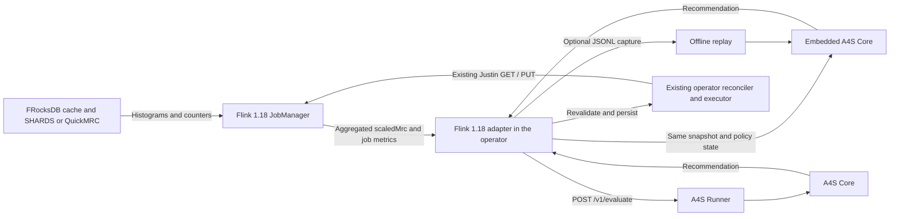

# Standalone A4S

A4S evaluates snapshots and recommends a memory and parallelism configuration. The Flink Kubernetes Operator owns reconciliation, checkpoint and recovery decisions, and the Justin resource update. The runner has no Flink client, Kubernetes credentials, or access to the streaming data path. Embedded mode remains the default.



`sources/a4s` is an independent Java 11 Maven build. `a4s-api` contains validated values and has no production dependencies. `a4s-core` depends on the API and evaluates locally. `a4s-http` provides the strict JSON contract and bounded HTTP client. `a4s-runner` hosts the core and replays the same request type. The Flink adapter lives inside the existing autoscaler Maven module and uses the same core in embedded mode and for validation of remote recommendations.

See the [dependency and baseline audit](a4s-standalone-baseline.md) for source pins and the separate online-calibration branch. Verification and benchmark status are recorded in [a4s-standalone-verification.md](a4s-standalone-verification.md).

## Build and run

Run these commands from the repository root with Java 11 or newer.

```bash
mvn -B -f sources/a4s/pom.xml clean verify
java -jar sources/a4s/a4s-runner/target/a4s-runner.jar
```

`A4S_BIND` defaults to `127.0.0.1`, and `A4S_PORT` defaults to `8080`. The runner accepts at most 2 MiB per request and allows 2 seconds for queued evaluation and response generation. The runner uses bounded HTTP and evaluation pools and serves structured logs with request status and duration. SIGTERM starts graceful shutdown.

```bash
curl --fail http://127.0.0.1:8080/health
curl --fail http://127.0.0.1:8080/v1/version
curl --fail -H 'Content-Type: application/json' \
  --data-binary @sources/a4s/examples/evaluate.json \
  http://127.0.0.1:8080/v1/evaluate
```

The example returns `RESCALE` to six subtasks with 44,739,243 bytes of cache per task and a state-preservation requirement. Its window and model clock are fixed to make the result reproducible.

## Deploy with the Flink operator

Build the runner image and make it available to the target Kubernetes namespace. Set `A4S_IMAGE` to the chosen registry and tag before running the commands.

```bash
mvn -B -f sources/a4s/pom.xml package
docker build -t "${A4S_IMAGE}" sources/a4s
docker push "${A4S_IMAGE}"
sed "s|image: a4s-runner:0.1.0|image: ${A4S_IMAGE}|" cluster/a4s/runner.yaml |
  kubectl -n "${A4S_NAMESPACE}" apply -f -
kubectl -n "${A4S_NAMESPACE}" rollout status deploy/a4s-runner
```

The Deployment has a ClusterIP Service and mounts no service account token. Restrict access to trusted control-plane clients using the deployment's existing network policy or TLS proxy. The runner accepts HTTP behind a trusted service boundary. Its client also supports HTTPS.

Build the Flink A4S operator with `images/flink-kubernetes-operator-a4s/build.sh`. The build installs the independent A4S reactor before compiling the operator. For a local Maven operator build, run `mvn -B -f sources/a4s/pom.xml install` and use the existing matching Flink SNAPSHOT build. Start with the existing Flink deployment and the following job configuration.

```yaml
job.autoscaler.enabled: true
job.autoscaler.scaling.enabled: true
job.autoscaler.justin.enabled: true
job.autoscaler.a4s.enabled: true
job.autoscaler.a4s.runner.url: http://a4s-runner:8080
job.autoscaler.a4s.runner.timeout: 3 s
job.autoscaler.a4s.snapshot.max-age: 60 s
```

Omit `job.autoscaler.a4s.runner.url` to use embedded mode. DS2 and Justin remain selected through the existing policy flags. A failed remote evaluation holds the current configuration. The same operator continues reconciling any previously persisted request and waits for observed applied profiles and parallelisms to match before admitting another request.

The adapter checks the job ID, RUNNING generation, vertex roster, parallelism and applied profiles before evaluation and again before storing a recommendation. For recorded output throughput, the adapter uses the Flink JobDetails output counter only when every sample in the measurement window has complete coverage and the counter stays monotonic. A missing, incomplete or resetting sample leaves the rate unavailable. Flink keeps TaskManager quota checks in the operator because slot sharing affects how task allocations map to workers. The check includes unchanged active vertices and rounds required slots up to whole TaskManagers. It also compares the proposed total TaskManager memory when per-worker memory changes. An allocation that reduces use of an existing quota may proceed even if it is still above the limit. For source vertices, the adapter requests `/a4s-metrics?get=observedSourceBacklogRecords`. The handler reports a sum only when every current running attempt has one unambiguous nonnegative `pendingRecords` counter. A complete zero is recorded as zero, and missing, invalid, ambiguous, or retired-attempt data leaves observed backlog absent. The gauges are the latest same-attempt observations available from Flink’s metrics fetcher. Flink’s legacy lag fallback continues to feed its existing sizing logic. The runner returns the snapshot ID, generation, decision ID and expiry. The adapter checks those identifiers and candidate values against the request. The fingerprint combines the job and vertex summary with each active subtask’s index, attempt number, deployment time and TaskManager ID from Flink’s vertex-details REST endpoint. Evaluation waits for a measurement window that starts after all current attempts have deployed. An incomplete roster or concurrent execution attempts defer the recommendation. A4S requires successful state-store persistence before realizing a new recommendation. On a failed reconciliation, the operator discards the state-store cache for that job and defers realization. The parallelism and resource-profile override maps must cover the same vertices before realization proceeds. The existing Justin write API is unchanged and lacks an atomic generation precondition. The operator remains the sole writer.

## API v1

`GET /health` returns service readiness. `GET /v1/version` returns service version, schema version and supported modes and models. `POST /v1/evaluate` accepts the structure in [evaluate.json](../sources/a4s/examples/evaluate.json) and returns a `ScalingPlan`. Send strict JSON with schema version 1 and a unique snapshot ID for each measurement. An unknown field, malformed payload or incompatible version returns a structured HTTP 400. A body exceeding the limit returns 413. Busy or interrupted evaluation returns 503, and an evaluation timeout returns 504.

| Field | Meaning |
| --- | --- |
| `snapshot` | Measurement window, execution identity, ordered operator topology, state backend and action capabilities. Supply workers when the platform can attest capacity allocated to this job. An empty worker list leaves worker feasibility with the controller. With a worker list, the policy checks that all proposed tasks fit together within individual worker memory and CPU bounds. The deterministic greedy check can hold a feasible candidate if it cannot find a packing. |
| `snapshot.operators` | Current allocation, permitted parallelism, target records/s, upstream IDs and optional telemetry. The adapter supplies the existing Flink per-vertex demand and current/ordinary proposed parallelism. |
| MRC / histogram | An MRC uses increasing operator-wide coordinates in bytes, decreasing miss rates in [0, 1], and an explicit capacity axis. A histogram uses per-partition capacity boundaries and interval counts. Cold and overflow references stay in the denominator. Merge only compatible, disjoint samples for the same interval. Convert cumulative readings to deltas after checking generation and counter monotonicity. |
| `constraints` | Per-task cache and managed bounds, whole-job CPU/cache budgets, optional worker capacities, snapshot lifetime, cooldown, and optional objectives. Unsupported latency, backlog, placement or unverifiable downtime objectives hold. |
| `policy` / `previousState` | Fixed hit and miss coefficients in seconds, search bound, allocation mode and controller-owned pending state. Unknown measurements are nullable and never default to zero. |
| `evaluatedAtMillis` | Explicit model time for repeatable decisions. The live adapter separately checks wall time before applying a recommendation. |
| `ScalingPlan` | Source identity, current and proposed allocations, action, modeled minimum and predicted throughput when supported, optional migration estimate, rationale, attempt count, model version, expiry and required state preservation. |

Possible actions are `NO_CHANGE`, `RESCALE`, `INSUFFICIENT_METRICS`, `INFEASIBLE_CONFIGURATION` and `UNSUPPORTED_ACTION`. The runner is stateless and repeated requests return the same decision for the same model inputs. Application remains the controller's responsibility.

`CACHE` uses an actual measured capacity axis and recommends actual cache bytes per task and in total. It can interpolate within measured capacity. A cache-sizing candidate must stay within that range after rounding and configured cache bounds, and must have a finite throughput forecast that meets the target. `LEGACY_SLOT_RESERVATION` preserves the baseline Flink formula that adds configured base memory to the operator-wide coordinate and rounds the result to managed MiB per task. Its result reports the managed reservation and the modeled minimum separately. Actual cache capacity and predicted throughput at that reservation remain unknown. See [legacy-retry.json](../sources/a4s/examples/legacy-retry.json).

V1 keeps the original fixed-latency equation and bounded greedy retry on supported points. It also rejects the baseline plateau fallback when no observed point meets demand, skips impossible all-hit candidates, and checks permitted parallelisms and final bounds. These can change results on edge inputs. When MRC data is unavailable on Flink, the adapter can still submit the existing ordinary throughput recommendation, preserving applied profiles. An independently sized RocksDB cache can take that horizontal path as well.

## Record and replay

Set `A4S_SNAPSHOT_DIR` to a writable benchmark-only mount in the operator. Set `job.autoscaler.a4s.snapshot.record-file` to a fresh basename such as `q8-remote-1.jsonl`. Recording writes a versioned JSONL row after each evaluation attempt. It captures the exact request and the returned recommendation, including its model version and rationale. An evaluation that returns no response has a null recommendation. Recording is capped at 256 MiB per file. The experiment archives actual runtime results separately.

```bash
java -jar sources/a4s/a4s-runner/target/a4s-runner.jar replay \
  --input snapshots.jsonl --policy a4s --output decisions.jsonl
```

Add `--verify` to require every replayed recommendation to match the recorded recommendation. Verification compares canonical JSON and reports the line of the first mismatch or missing recommendation. Replay publishes the output after processing all rows successfully. Existing request-only JSONL files can still be replayed.

`--policy a4s` uses the captured mode. `CACHE` and `LEGACY_SLOT_RESERVATION` select an alternate mode for comparison with the same recorded constraints and capabilities, which may reject the new mode. To compare model parameters, edit a copy of the captured request file and retain both inputs and outputs. A prediction from replay is a model estimate. Stateful recovery, live throughput, and performance under an alternative configuration require a deployment or validated simulator.

## Local checkpoint rescale smoke

Build the runner JAR and the Flink operator. Set `FLINK_CLASSPATH` to a colon-separated runtime classpath with the matching patched Flink 1.18 runtime, streaming API, clients, RocksDB backend, and their dependencies. Include the matching RocksDB JNI JAR and make its native libraries available to the JVM. The script uses Java 11 or later and GNU `timeout`.

```bash
scripts/a4s/smoke-local-flink-rescale.sh "$FLINK_CLASSPATH" /tmp/a4s-smoke
```

The script starts a local Flink MiniCluster and a separate runner JVM on loopback. It checkpoints a deterministic source and keyed RocksDB state after the first 100 records. The Flink executor sends fixed demand and miss-rate inputs to the runner and validates the result against live Flink details. The test driver submits the stored overrides through Justin, waits for the stateful vertex to reach parallelism 2 with the same applied slot profile, then releases the remaining records. It checks every ID and keyed count through record 200 and verifies the recorded recommendation by replay. Logs and JSONL evidence go into a fresh directory under the requested output path.

## Native instrumentation and future adapters

The C++11 [SHARDS estimator](../sources/libs/frocksdb/util/shards/) builds independently with CMake. FRocksDB still supplies its original seeded hash, scoped cache keys, charge and admission semantics. The RocksDB wrapper retains the JNI snapshot layout and cumulative counters. Flink's existing histogram aggregation and `scaledMrc` endpoint still publish aggregate observations. The network service receives no individual cache access.

To add a future Flink 2.x adapter, implement metrics and job-graph discovery using that version's public REST or operator interfaces. Carry a generation and task roster across the measurement window. Verify supported memory, parallelism and recovery operations with the deployment and use the adapter's stateful update mechanism. Account for state ownership, applied profiles and pending reconciliation before accepting a plan. Expose real cache capacity when the backend can attest it and keep aggregate provenance for SHARDS or equivalent telemetry. ForSt and asynchronous or remote state require new cost calibration and validation for the I/O path, cache scope, and state restoration behavior. `PerformanceModel` and `MigrationCostModel` are extension points. A Flink 2.x adapter, online-cost port, learned predictor, concrete migration model and physical placement planner remain future work.
