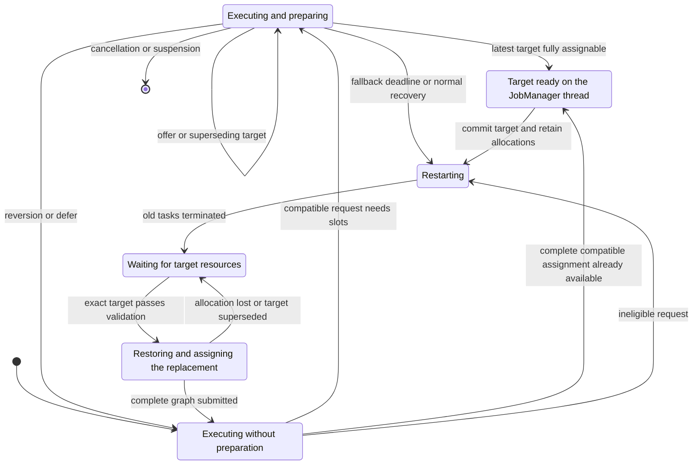

# Conditional slot preparation for native rescaling

The Adaptive Scheduler can acquire compatible slots for a horizontal native rescale while the current graph remains `RUNNING`. The feature is opt-in and uses the regular checkpoint restore and allocation path after committing a target. A4S, DS2, and Justin continue to select parallelism and memory with their existing policies.

## Configuration

Set these keys under `FlinkDeployment.spec.flinkConfiguration` before starting the JobManager. The operator's `FlinkConfigBuilder` merges that map into the effective Flink configuration. Verify it with `GET /jobmanager/config`.

```yaml
jobmanager.scheduler: adaptive
job.autoscaler.native-rescale.preallocation.enabled: "true"
job.autoscaler.native-rescale.preallocation.timeout: "15 s"
job.autoscaler.native-rescale.preallocation.timeout-action: "fallback"
```

The default is `enabled: false`. Use `defer` to keep processing on the current graph at a preparation timeout. A configured limit that rejects the temporary demand is also deferrable. The default fallback proceeds with the immediate native restart and the existing allocation deadline, including when a quota makes the target unobtainable.

## Existing allocation and restart path

1. The operator builds a native request from its overrides and the Justin resource requirements response. The Dispatcher validates the vertex roster and bounds, serializes the request into the job graph store, and forwards it to the JobMaster. The response acknowledges submission.
2. The scheduler replaces each job vertex's slot-sharing group with a dedicated group matching the requested profile, declares the total target demand, and notifies its resource listener. Requirement changes and slot offers both enter `Executing.maybeRescale()`. With preparation disabled, `shouldRescale()` authorizes the immediate native restart once.
3. `DeclarativeSlotPoolService` forwards the job's total demand to the ResourceManager. The SlotManager's `JobScopedResourceTracker` accounts for acquired resources. The SlotManager uses registered and pending capacity, then asks the active ResourceManager for workers as permitted. The Kubernetes driver creates TaskManager pods. Kubernetes schedules them, the TaskExecutors register and receive slots, and the JobMaster accepts matching slot offers into its pool.
4. `Restarting` cancels the old graph. After task termination, `WaitingForResources` retains matching allocations and releases excess slots. Desired-resource and sufficient-resource checks require the complete native target. `JustinSlotAssigner` maps execution slot-sharing groups to distinct allocations. The factory builds and restores the graph, and the allocator verifies every expected slot is free before reserving and deploying it.

The earlier experiment removed by `dc8fbf56` declared the target before qualifying concurrent feasibility, inferred occupied demand from execution vertices, and shared a 60-second timer across updates. Per-vertex parallelism can misrepresent physical demand for shared slots. Exact-profile replacements can depend on memory or CPU still occupied by the live graph. In the historical c167 P24 replay, the target required seven workers and the namespace admitted five. A request acknowledgement and pending worker request could therefore precede an impossible assignment. PR #5 also corrected the extra restart a waiting-state update could otherwise arm.

## Resource accounting

Preparation requires dedicated, concrete groups with per-vertex parallelism that stays the same or grows. Every old task must be `RUNNING` with a live logical slot. The pool inventory must agree with the occupied allocation IDs and their profiles. The target counts every dedicated group, including sources. A general shared group's physical count is the maximum parallelism of its member vertices. The native path splits those groups, so this implementation bypasses preparation for shared startup graphs.

Let `C` be the occupied allocations and `T` the target requirements. Match the occupied allocations to get `R` and compatible free allocations to get `F`. The planner's additional deficit is `T - R - F`. Its temporary declaration is `C + (T - R)`. Eligibility requires every occupied allocation to match exactly, so the temporary total equals `T`. Free slots are part of that total. The ResourceManager accounts for its acquired slots.

For four occupied slots and three compatible free slots targeting 12, the scheduler declares 12 and the additional deficit is five. For four occupied 256 MiB slots targeting two 512 MiB slots, the scheduler uses native restart and releases the old slots before waiting for replacements. The bounded preparation path never waits for those profiles to coexist.

The matcher processes exact concrete profiles first, unspecified requirements second, and physical wildcard slots last. Allocation IDs are used once. Preparation, final readiness, excess-slot retention, and Justin assignment share the matcher. Configured slot, CPU, and memory caps constrain the demand. Pod quotas, TaskManager packing, other applications, and physical headroom still affect feasibility.

## Scheduler lifecycle



The live graph and its metadata remain active throughout preparation. Requirement callbacks and slot notifications reevaluate the latest target on the JobManager main thread. The deadline belongs to the preparation window. A newer target replaces the pending one and recalculates demand. A duplicate is idempotent with the feature enabled. A reversion closes the window and withdraws temporary demand. A callback belonging to a closed window cannot start a restart.

The slot pool continues to own prepared free allocations. The idle sweep skips selected IDs through preparation and redeployment. The ordinary allocator can reserve them, and the target declaration stays active through restart. Withdrawal restores normal idle reclamation for surplus allocations. A worker loss can invalidate readiness, so the waiting and reservation checks still apply. A change to the pending target invalidates any stale replacement snapshot before assignment.

A recovered JobManager with the feature enabled uses the latest persisted target when starting without a running graph. The in-memory preparation window, timer, and selected IDs end at leadership loss. A persisted deferred target can therefore be reconsidered at recovery. If a recoverable task failure interrupts the live graph during preparation, Flink's normal restart can apply the latest target without a second restart.

## Status and timing

`GET /jobs/<job-id>/justin?include-applied-profile=true` reports the requested bounds and profile, the observed applied parallelism and exclusive physical profile when available, and, with the feature enabled, a generation and status for the latest request. A generation is local to a JobManager incarnation. `PREPARING`, `COMMITTING`, `DEFERRED`, and `ABORTED` describe the request. `APPLIED` requires the corresponding subtasks to be running. The default representation retains its existing shape. Operator history can record the native outcome while tracking stabilization from the replacement graph's running timestamp.

The JobManager emits `NATIVE_RESCALE_*` events for request receipt, declaration, first TaskManager registration and newly accepted slot when observed, readiness, commit, timeout, fallback, old-task termination, graph construction, checkpoint restore, and all target tasks running. The autoscaler emits its decision timestamp for the opt-in path. A manual run records it at the controller before submission. Application record progress, recovery, backlog clearance, and latency require workload observations.

Excluded cases include shared or unspecified startup groups, scale-downs, mixed or vertical changes, and ambiguous occupancy. Kubernetes quota and packing constraints can cause a bounded attempt to time out. The [Q8 protocol](../experiments/native-rescale-preallocation/README.md) specifies how to verify processing during preparation and measure performance.

Prior changes reviewed include [missing MRC handling](https://github.com/johnymeng/flink-kubernetes-autoscaling/pull/3), [native slot reuse](https://github.com/johnymeng/flink-kubernetes-autoscaling/pull/5), [RocksDB histogram lifecycle](https://github.com/johnymeng/flink-kubernetes-autoscaling/pull/6), [initial slot preparation](https://github.com/johnymeng/flink-kubernetes-autoscaling/commit/f11fc81e8677898ad3a03d26d88151dfca8ddd07), and [removal of the earlier delay](https://github.com/johnymeng/flink-kubernetes-autoscaling/commit/dc8fbf565b1000506718f65e555c9c50d0a8dac69).
