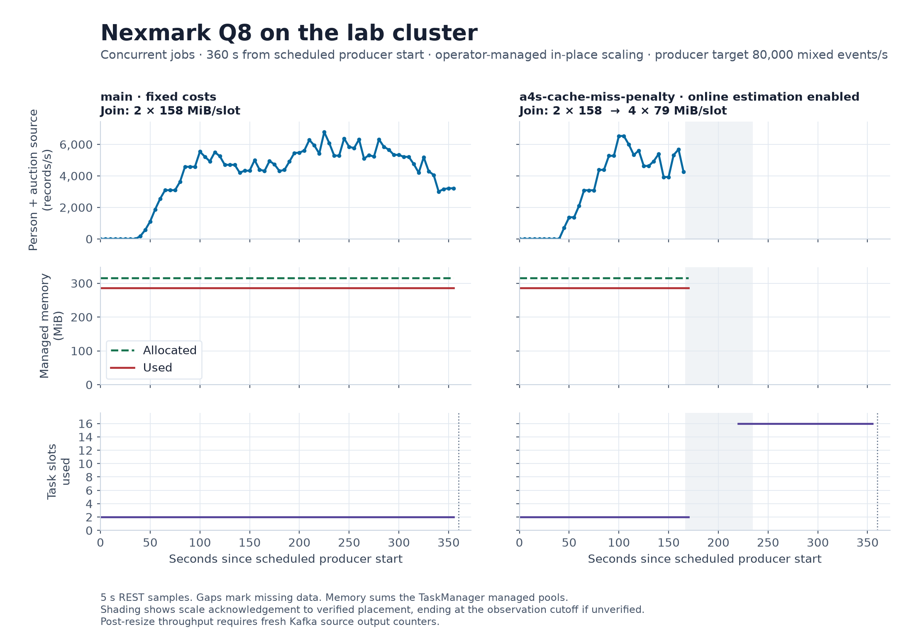

# Nexmark Q8 with native in-place scaling

The online-enabled branch reached 16 occupied slots under its original JobManager. All 16 tasks were running 67.0 seconds after the scaling report. Main stayed at two occupied slots throughout the 360-second observation and reported `MissRateCurve has no points`.

Both jobs started with two occupied slots on one TaskManager and ran concurrently on the same lab worker. Each used its own built-in A4S operator, Kafka broker and producer. The Q20-style producer targeted 80,000 mixed Nexmark events/s. People and auctions account for about 8% of that stream, or roughly 6,400 Q8 input records/s at the target rate. Broker end-offset deltas during sampled producer generations averaged 81,196 mixed events/s on main and 84,151 on the branch. Those averages exclude producer downtime.

| Branch milestone | Time after scheduled producer start | Time after scaling report |
| --- | ---: | ---: |
| Operator reported scaling | 164.7 s | 0.0 s |
| Operator acknowledged in-place scaling | 167.1 s | 2.4 s |
| First REST sample with 16 occupied slots | 220.0 s | 55.3 s |
| All four join subtasks running | 223.3 s | 58.7 s |
| All 16 tasks running | 231.6 s | 67.0 s |
| First REST sample confirming placement and memory | 234.7 s | 70.0 s |
| Producer confirmed running from event 1 after reset | 265.5 s | 100.8 s |

The table uses the precise operator log time of 21:01:45.141535870 UTC. Kubernetes rounded the same event to 21:01:45 UTC, so the checker reports 70.158 s to the placement sample. The eight TaskManagers provided four 79 MiB join slots and the source vertices stayed at parallelism two. The two global window aggregates and the join each moved from parallelism two to four. Flink's adaptive scheduler restarted the execution graph inside the same JobManager during the resize.

## Runtime fix

On the original runtime, the native update failed with `java.io.NotSerializableException: org.apache.flink.runtime.jobgraph.justin.JustinVertexResourceRequirements` 2.7 seconds after the scaling report. The operator fell back to its regular upgrade and replaced the JobManager. Commit `b5ebce17` makes the per-vertex requirements serializable. Its regression test writes requirements for two vertices to a job graph, recovers the graph and checks their parallelism bounds and resource profiles. It reproduced the original exception and passed with the corrected runtime.

The rerun pinned main's autoscaler to `f8ce7fbb` and the branch's to `a86d5b1c`. Both used the same six worker and workload artifact digests, including the corrected `savepoint-profiles.jar` with SHA-256 `862c4ad2b80f6c562213012ed8010d64af41d2adbdf2d33bf3e4f8c7209f521b`.

## Interpreting the charts

The branch skipped the join's miss-rate curve for this decision. The initial slot allocation shared each of its two slot-scoped RocksDB caches across multiple stateful operators. The cache-cost gauges were registered and empty, and no join penalty qualified in the run. The scaling difference therefore cannot quantify a benefit from the fitted cache-miss penalty.

After the resize, all 48 recorded consumer partition offsets stayed flat and the Flink source meter repeated its last value of 4,253.05 records/s. The new broker independently recorded 60,843,801 bytes fetched from the person topic and 337,942,990 bytes from the auction topic. Those cumulative fetches establish that the replay served Q8 data. They provide no per-second processing rate. The charts leave the unverified source interval and unavailable managed-memory readings blank.

[Main chart](q8-main-ryan.png) · [Branch chart](q8-branch-ryan.png) · [Five-second samples](q8-resource-series.csv) · [Placement and policy results](native-results.json)
